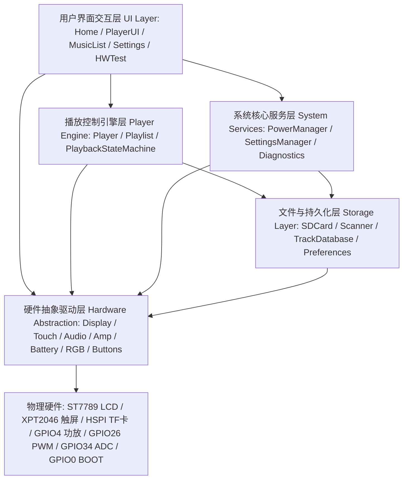
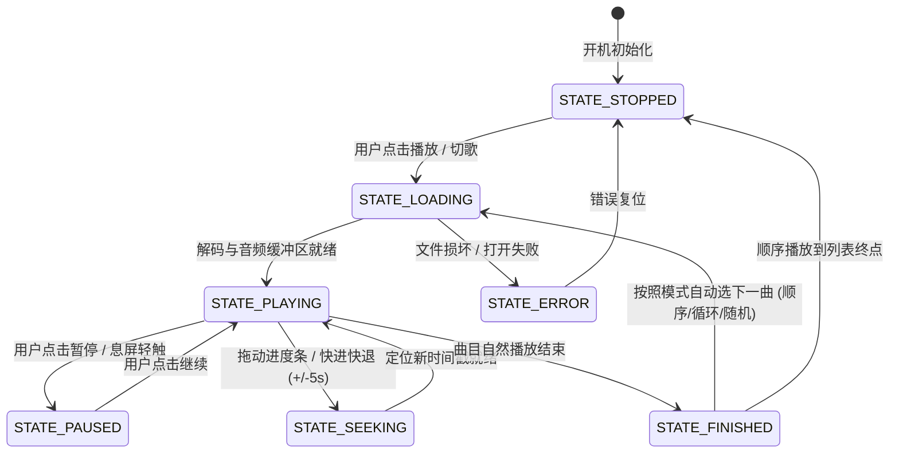

# Bailan MP3 Player 系统架构设计说明书 (ARCHITECTURE.md)

> **项目定位**: 基于 ESP32-2432S028R Plus 的便携式嵌入式音频播放器与科技竞赛创新原型平台  
> **设计哲学**: 模块化分层、非阻塞事件驱动、防爆音硬件消噪、零内存碎片、断电持久化。

---

## 1. 总体分层架构图

系统采用清晰的 5 层分层解耦架构：



---

## 2. 核心状态机 (Playback State Machine)

播放器核心引擎严格采用显式状态机流转，杜绝多层深层嵌套的 `if-else`：



---

## 3. 内存与资源预算 (Memory Budgeting)

由于 ESP32-2432S028R Plus **无外部 PSRAM**，仅具备 320KB 片上 SRAM（实际堆内存约 180~210KB 可用），内存管理是保障设备长期稳定运行不崩溃的核心生命线：

1. **防碎片机制 (Anti-Fragmentation)**:
   - 全局静态分配播放列表与曲目缓存（`MAX_TRACKS 32`，每项固定 `sizeof(TrackInfo)` 结构体）；
   - 杜绝在主循环和高频 UI 刷新中频繁调用 `new`/`delete` 或大尺寸 `String` 字符串动态拼接；
   - UI 采用静态组件渲染，只维护状态标志，不重复销毁/重建物体。
2. **Flash 损耗均衡保护 (Flash Wear-Leveling)**:
   - 播放器持久化状态（上次曲目、音量、亮度、播放模式）保存在 ESP32 NVS（Preferences 分区）；
   - 断点续播时间戳采用非阻塞节流写入（间隔不低于 15 秒或仅在切歌/退出时持久化），严禁按秒高频擦写 Flash。
3. **RAM 占用实测 (v0.1.0)**:
   - **RAM 使用**: 27,148 字节 (8.3%)，剩余 >290KB 可用堆内存，为后续 MP3 硬件流式解码预留充裕空间。
   - **Flash 使用**: 413,933 字节 (31.6%)，剩余近 900KB Flash。

---

## 4. 科技创新竞赛级扩展规范 (Competition Diagnostics)

为了支撑科技创新答辩、实验数据采集与功耗评估，系统在 `src/system/diagnostics.cpp` 提供了标准的系统运行遥测接口：

- `diagnostics_get_free_heap()`: 实时获取动态空闲堆内存（字节）；
- `diagnostics_get_min_free_heap()`: 获取系统启动以来的历史最低堆内存水位（用于验证是否有内存泄漏）；
- `diagnostics_get_uptime_sec()`: 获取持续无故障运行时间（秒）；
- `battery_get_voltage()`: 获取精密毫伏级供电电压；
- 串口周期性输出标准化格式报文：
  ```text
  [SYS] Uptime: 120s | Heap: 182400B (Min:175200B) | Batt: 4.18V | TF: AVAILABLE | Player: PLAYING
  ```
